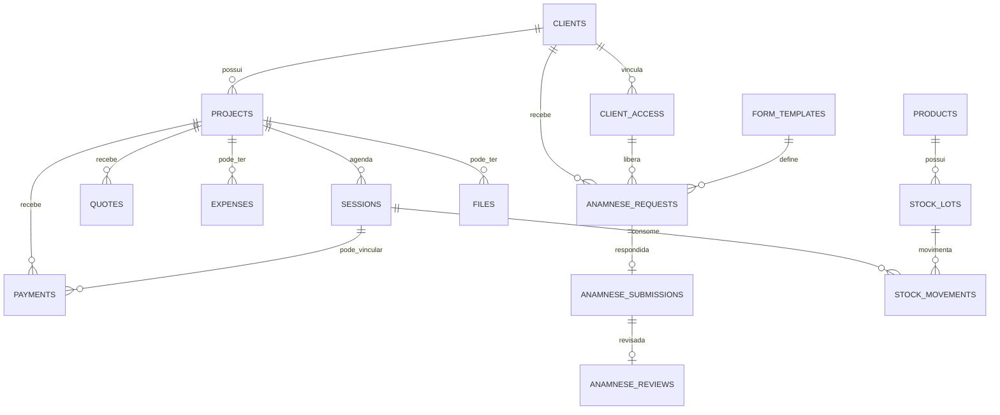

# Planetário Estúdio — modelo Firestore

Modelo lógico de **um estúdio, um proprietário e clientes autenticados por Google**, sem SQL ou migrations. Documentos têm ID automático/estável, `createdAt` e `updatedAt` (timestamps do servidor) quando aplicável. Campos em centavos terminam em `Cents`; instantes são UTC. Dados de cliente jamais aparecem no repositório. As coleções abaixo são top-level para consultas simples; `clientId`, `projectId` e `sessionId` conectam registros.

## 1. Coleções do MVP

| Coleção | Campos principais | Relações e observações |
|---|---|---|
| `settings/app` | nome do estúdio, fuso, moeda, horários, políticas, tema | documento único, dono define conteúdo |
| `settings/owner` | uid, email, createdAt | bootstrap restrito ao Google verificado `planetariomkt@gmail.com`; UID fica fixo após a criação |
| `clients/{id}` | name, birthDate opcional, phone, whatsapp, email, instagram, source, notes, active | um cliente tem vários projetos; busca por nome normalizado |
| `projects/{id}` | clientId, name, description, style, bodyArea, estimatedSizeCm, colorMode, status, priceCents, estimatedMinutes, notes | referência ao cliente; preço acordado é fonte do saldo |
| `sessions/{id}` | projectId, startAt, endAt, status, plannedMinutes, actualMinutes, realizedValueCents, notes | uma ou mais sessões por projeto; duração positiva |
| `quotes/{id}` | projectId, version, status, items, estimatedMinutes, priceCents, discountCents, depositCents, validUntil, terms, pricingSnapshot, sentAt, decidedAt | PDF gerado no navegador; versão enviada não é alterada |
| `payments/{id}` | projectId, sessionId opcional, kind (`sinal`/`sessão`/`outro`/`devolução`), signedAmountCents, method, occurredAt, note, originalPaymentId opcional, voidedAt/voidReason opcionais | recebimento positivo; devolução negativa ligada ao original; anulado sai dos totais mas permanece no histórico |
| `expenses/{id}` | category, amountCents, paidAt, method, projectId opcional, note | saída efetiva; sem contas a pagar automatizadas |

## 2. Identidade do cliente e anamnese no lançamento

| Coleção | Campos principais | Escrita e vínculo |
|---|---|---|
| `pendingAccounts/{googleUid}` | uid, verifiedGoogleEmail, requestedAt | cliente Google cria **somente o próprio** pedido; sem acesso clínico |
| `clientAccess/{googleUid}` | clientId, verifiedGoogleEmail, active, linkedAt, linkedBy | **somente proprietário** cria/revoga após conferir o cadastro; UID é chave, email é conferência adicional |
| `formTemplates/{templateId}` | version, questions, questionIds, requiredQuestionIds, procedureTerm, imageConsentTerm, publishedAt | proprietário publica nova versão imutável; versão vigente é a maior publicada |
| `anamneseRequests/{requestId}` | clientId, projectId, assignedUid, sessionId opcional, templateId, expiresAt, requestedAt, status (`criada`/`enviada`/`revogada`) | proprietário cria e envia link com ID aleatório após vínculo; respondida/revisada derivam de documentos relacionados |
| `anamneseSubmissions/{requestId}` | clientId, projectId, requestId, googleUid, googleEmail, templateId/version, answers, procedureAccepted, imageUseAccepted, signedAt, authMethod, authTimeSeconds | cliente vinculado cria **uma vez**; respostas e aceite imutáveis; texto do termo vem do template imutável; `signedAt` = horário do servidor; autenticação recente registrada |
| `anamneseReviews/{requestId}` | reviewerUid, reviewedAt, outcome, note | somente proprietário registra revisão; não altera a submissão |

`requestId` identifica uma solicitação e uma submissão. O link **não é autorização por si só**: regras exigem Google verificado, `clientAccess/{uid}` ativo para o `clientId` solicitado, solicitação válida e campos coerentes. Email digitado no formulário nunca determina vínculo. Cliente não lê `clients`, outros pedidos, finanças ou anamnese alheia; recebe apenas a versão aplicável e sua própria submissão. Uma correção requer nova solicitação/revisão, mantendo a anterior.

`quotes.items` é uma lista curta de itens, sem coleção separada. Não guardar resumo financeiro em `projects`, pois `priceCents - soma(payments)` é calculável; se o volume exigir agregados no futuro, incluir mecanismo e testes de conciliação. A busca de nomes pode usar `searchName` normalizado, sem serviço externo.

## 3. Estoque no lançamento e arquivos da fase 5

| Coleção | Campos principais | Relações e observações |
|---|---|---|
| `products/{id}` | name, unit, category, quantity, minQuantity, defaultUnitCostCents, active | produto da fase 4; saldo total atualizado em transação |
| `stockLots/{id}` | productId, lotNumber opcional, expiryDate opcional, supplierName opcional, quantity, unitCostCents | lote da fase 4; para item sem lote, um registro padrão sem número/validade |
| `stockMovements/{id}` | productId, lotId, sessionId opcional, type (`entrada`/`consumo`/`perda`/`ajuste`), quantityDelta, unitCostCents, occurredAt, note, operationId | movimento da fase 4; saldo de produto e lote atualizados juntos; operação idempotente |
| `files/{id}` | ownerType, ownerId, category, storagePath, mimeType, size, createdAt | metadados de arquivo privado da fase 5; caminho não é URL pública |

Lote, validade e fornecedor informado entram quando aplicáveis. Cadastro completo de fornecedores, kits e pedidos/listas de compras ficam para a fase 6 opcional. Não registrar insumo sujeito a rastreabilidade como “sem lote” quando o lote existir na embalagem.

## 4. Diagrama lógico

O desenho representa referências por ID, **não foreign keys**. Na exclusão, arquivar cliente/projeto é preferível a apagar dados relacionados. Exclusão definitiva requer rotina de exportação e verificação de dependentes.

## 5. Consultas e integridade

- Consultas: clientes por `searchName`; projetos por `clientId`/status; sessões por intervalo `startAt`; orçamentos e pagamentos por `projectId`; entradas por data; lotes por produto/validade; movimentos por produto/sessão. Criar somente índices compostos solicitados pelo Firebase para essas telas, versionando `firestore.indexes.json`.
- Validar no formulário e em regras: tipos, tamanho máximo de texto, valores não negativos, início antes do fim, listas curtas, campos permitidos e autor autenticado. Firestore Rules não são substituto de uma API com lógica de negócio; o MVP de conta única aceita essa limitação.
- Criação de projeto requer cliente existente; criação de sessão/orçamento/pagamento requer projeto existente. Implementar validações na operação e, quando possível, nas regras com `exists()` sem consultas amplas.
- Somente proprietário lista pedidos pendentes e cria `clientAccess`. Cliente faz `get` de um pedido pelo ID recebido e submete se o `clientId` vinculado ao UID corresponder. As regras validam provedor Google, email verificado, vínculo ativo, versão, prazo e `signedAt == request.time`; cliente não atualiza nem apaga submissão. Revisão é registro administrativo separado.
- Reagendamento e mudanças de status preservam evento em `history` curto no documento ou coleção `events` se crescer. Orçamentos enviados têm novas versões em documentos novos. Devolução cria novo `payment` negativo ligado ao original; lançamento inserido por engano é marcado como anulado com motivo, sem alterar o caixa histórico se nunca houve movimento real.
- Transação para `products.quantity` + `stockLots.quantity` + `stockMovements`; conferir saldo não negativo e validade antes de consumir. Documento de movimento usa ID de operação estável para evitar duplicação por clique duplo. Transações falham offline; mostrar falha, não sucesso provisório. Ver [transações Firestore](https://firebase.google.com/docs/firestore/manage-data/transactions).

## 6. Evoluções deliberadamente fora do MVP

Equipe administrativa demandará papéis, escopo por profissional e revisão completa das regras. Multiestúdio demandará particionamento por estúdio. Aprovação pública de orçamento, assinatura qualificada e automações podem exigir backend/provedor especializado. Financeiro com contas a receber/pagar, parcelas e comissões terá entidades próprias; não simular isso em campos improvisados agora.
